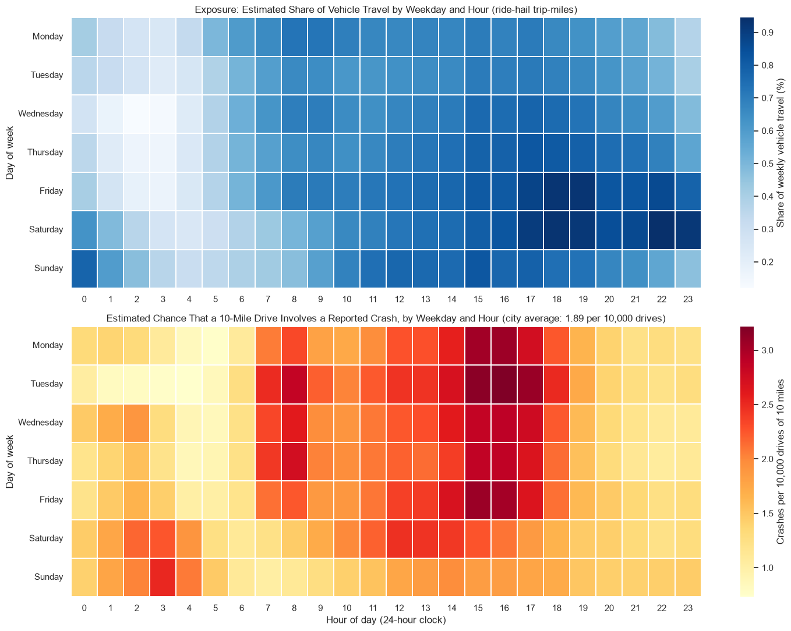
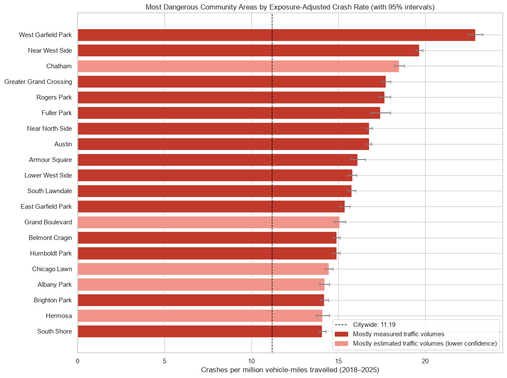
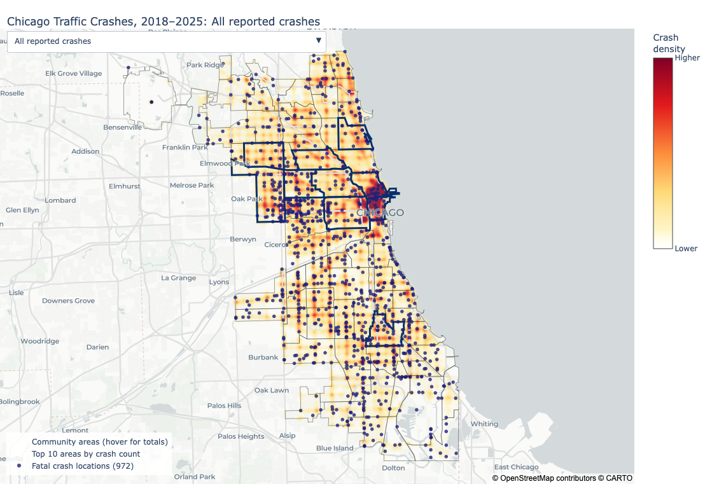

# Chicago Traffic Crash Analysis (2018–2025)

**Where and when is it most dangerous to travel in Chicago, not just busiest?**

This project analyzes **877,919 reported traffic crashes** in Chicago from 2018 through 2025. It combines crash and injury records with traffic volumes, ride-hail trips, transit boardings and bike-share trips to estimate **risk per mile driven**. It then identifies the community areas, times of week, intersections and street corridors that transportation safety planners should look at first.

**[▶ Explore the interactive maps](https://08armon.github.io/chicago-traffic-crash-analysis/)** · [Analysis notebook](notebooks/02_analysis.ipynb) · [Data collection and cleaning notebook](notebooks/01_data_collection_and_cleaning.ipynb)

**Tools:** Python, pandas, GeoPandas, Plotly, Matplotlib, seaborn, Socrata and ArcGIS REST APIs

---

## Key findings

1. **The busiest time to drive is also the riskiest.** On weekdays from 3 to 7 p.m., about **2.88 of every 10,000 ten-mile drives** involve a reported crash, more than twice the overnight rate (1.35) and well above the city average (1.89).
2. **High crash counts and high risk are in different places.** Austin, the Near West Side and the Near North Side have the most crashes. Per mile driven, **West Garfield Park** is the most dangerous area (22.88 crashes per million vehicle-miles, about twice the citywide 11.19), followed by the Near West Side, Chatham, Greater Grand Crossing and Rogers Park.
3. **Serious injuries are concentrated on the West and South Sides.** Citywide, 1.83% of crashes involve a death or incapacitating injury; the share reaches 2.89% in West Garfield Park. Relative to traffic, West Garfield Park's serious-crash rate is about three times the citywide level.
4. **Greater Grand Crossing is the only community area in the top 15 on all five measures:** total crashes, serious crashes, serious-outcome share, crashes per resident and crashes per mile driven.
5. **Crashes cluster at intersections and a few corridors.** 62.6% of crashes happen at intersections. The Lake Shore Drive curve at Oak Street has the most crashes of any intersection (1,059), and the blocks where the Dan Ryan Expressway meets the street grid make up 5 of the 15 highest-count half-mile corridors.
6. **Injuries are becoming a larger share of crashes.** Total crashes have been flat since 2021, but the share involving injuries rose from about 15% in the summers of 2018–2019 to 18–19% in 2024–2025.

## Key visuals

**Estimated chance that a 10-mile drive involves a reported crash, by weekday and hour.** The weekday afternoon peak is the riskiest time per drive, not just the busiest.



**Community areas ranked by crashes per million vehicle-miles travelled**, with 95% intervals. Lighter bars rely mostly on estimated (not counted) traffic volumes.



**Crash density across Chicago.** [Open the interactive version](https://08armon.github.io/chicago-traffic-crash-analysis/maps/crash_density_and_risk.html) to switch between crash types, times of day and exposure-adjusted risk views.



## Interactive maps

The maps are published with GitHub Pages because GitHub does not display interactive charts inside notebooks.

| Map | What it shows |
|---|---|
| [Crash density and exposure-adjusted risk](https://08armon.github.io/chicago-traffic-crash-analysis/maps/crash_density_and_risk.html) | Every geocoded crash on a heat map, with views for injury, serious, peak-hour and late-night crashes, plus corridor and intersection crash rates relative to traffic |
| [Crashes by community area](https://08armon.github.io/chicago-traffic-crash-analysis/maps/crashes_by_area.html) | Total reported crashes in each of Chicago's 77 community areas |
| [Serious-outcome share by community area](https://08armon.github.io/chicago-traffic-crash-analysis/maps/serious_share_by_area.html) | Percentage of crashes involving a death or incapacitating injury |
| [Intersection and corridor hot spots](https://08armon.github.io/chicago-traffic-crash-analysis/maps/hotspots.html) | The top 25 intersections and half-mile corridors by crashes, serious crashes and crash rate |
| [Risk by area and time of week](https://08armon.github.io/chicago-traffic-crash-analysis/maps/risk_by_area_and_time.html) | Estimated per-drive crash risk in each community area for six time windows |

## Recommendations

The analysis points to ten locations and programs for further study. The top three, framed as **candidate interventions for evaluation** (drawn from the Federal Highway Administration's [Proven Safety Countermeasures](https://highways.dot.gov/safety/proven-safety-countermeasures)):

1. **West Side arterials (West Garfield Park, East Garfield Park, Austin):** area-wide speed management, evaluation of road diets on four-lane sections of Cicero Avenue, Central Avenue and Pulaski Road, and safer pedestrian crossings at signals and bus stops.
2. **Dan Ryan Expressway interchanges (87th, 79th and 63rd Streets, Garfield Boulevard, Cermak and Roosevelt Roads):** protected left-turn phases, leading pedestrian intervals and refuge islands at the ramp signals, especially on walking routes to Red Line stations.
3. **Lake Shore Drive curves at Oak Street and 57th Street:** speed management on the curves, high-friction pavement, and better curve warning and lane markings.

The full list, with evidence and lead agencies, is in [Section 9 of the analysis notebook](notebooks/02_analysis.ipynb). These are candidates for engineering review, not proven fixes: the analysis shows where and when to look, not what caused each crash.

## Data and methods

| Data | Source | Used for |
|---|---|---|
| [Traffic Crashes – Crashes](https://data.cityofchicago.org/d/85ca-t3if) | City of Chicago | One record per reported crash |
| [Traffic Crashes – People](https://data.cityofchicago.org/d/u6pd-qa9d) | City of Chicago | Injury severity for each person involved |
| [Street centerlines](https://data.cityofchicago.org/d/pr57-gg9e) | City of Chicago | Every street block, used to match crashes to streets and intersections |
| IDOT Annual Average Daily Traffic | Illinois Department of Transportation (ArcGIS REST service) | Traffic volume on counted roads |
| [Average Daily Traffic from cameras](https://data.cityofchicago.org/d/gc7y-n4xa) | City of Chicago | Traffic volume near traffic and speed cameras |
| Ride-hail trips ([2019](https://data.cityofchicago.org/d/m6dm-c72p), [2024](https://data.cityofchicago.org/d/n26f-ihde)) | City of Chicago | How travel is spread across the hours of the week |
| CTA 'L' entries and bus boardings ([stations](https://data.cityofchicago.org/d/8pix-ypme), [entries](https://data.cityofchicago.org/d/5neh-572f), [bus stops](https://data.cityofchicago.org/d/mq3i-nnqe)) | City of Chicago / CTA | Pedestrian activity indicator |
| [Divvy bike-share trips (2018–2019)](https://data.cityofchicago.org/d/fg6s-gzvg) | City of Chicago | Cycling activity indicator |
| [Community-area boundaries](https://data.cityofchicago.org/d/igwz-8jzy) and [population](https://data.cityofchicago.org/d/t68z-cikk) | City of Chicago | Area assignment and per-resident rates |

**Method in brief**

- **Cleaning:** audited repeated crash IDs, documented every exclusion, and collapsed person-level injury records to one row per crash. A *serious-outcome crash* involves at least one death or incapacitating injury.
- **Exposure model:** every street block gets a daily traffic volume (camera count, then IDOT count, then the median for its road type). Volume × length × days gives **vehicle-miles travelled (VMT)**.
- **Rates:** crashes per million VMT for areas and corridors, crashes per million entering vehicles for intersections, with approximate 95% Poisson intervals. Rates are converted into the chance that a 10-mile drive involves a crash.
- **Robustness checks:** intersection and corridor rates are ranked only when they rest on at least 30 crashes and mostly measured traffic. Locations right next to a much busier road (such as streets alongside Lake Shore Drive) are left out of the rate rankings, because crashes on the busy road are often recorded there. This rule was added after an early run showed the problem.

## Limitations

- About 59% of estimated vehicle-miles come from measured counts; the rest use typical volumes for each road type. Results for areas that rely mostly on estimates are flagged as lower confidence.
- The hour-by-hour travel pattern comes from a sample of ride-hail trips, which over-represent evenings and weekends.
- Transit boardings and bike-share trips are indicators of walking and cycling, not complete counts.
- The data describe reported crashes only, and spatial patterns do not establish causes.

## Repository structure

```
chicago-traffic-crash-analysis/
├── README.md                    ← this page
├── requirements.txt             ← Python packages needed to run the notebooks
├── notebooks/
│   ├── 01_data_collection_and_cleaning.ipynb   ← downloads, cleaning, exposure model
│   └── 02_analysis.ipynb                       ← executive summary, analysis, findings, recommendations
├── images/                      ← charts used in this README (written by notebook 2)
├── docs/                        ← GitHub Pages website
│   ├── index.html               ← map gallery
│   └── maps/                    ← interactive maps (written by notebook 2)
└── data/                        ← not uploaded; recreated by notebook 1 (see data/README.md)
```

## How to run

1. Clone the repository and install the packages:
   ```bash
   git clone https://github.com/08armon/chicago-traffic-crash-analysis.git
   cd chicago-traffic-crash-analysis
   pip install -r requirements.txt
   ```
2. Open `notebooks/01_data_collection_and_cleaning.ipynb` and run all cells. The first run downloads the data into `data/raw/` and can take a while; later runs reuse the saved files. It finishes by saving `data/processed/prepared_data.pkl`.
3. Open `notebooks/02_analysis.ipynb` and run all cells. It refreshes the charts in `images/` and the interactive maps in `docs/maps/`.

## Author

**Armon Saeedvafa** · [LinkedIn](https://www.linkedin.com/in/armon-saeedvafa-08a74a405/) · [GitHub](https://github.com/08armon)

Data: City of Chicago Data Portal and Illinois Department of Transportation. This is an independent analysis and is not affiliated with either agency.
